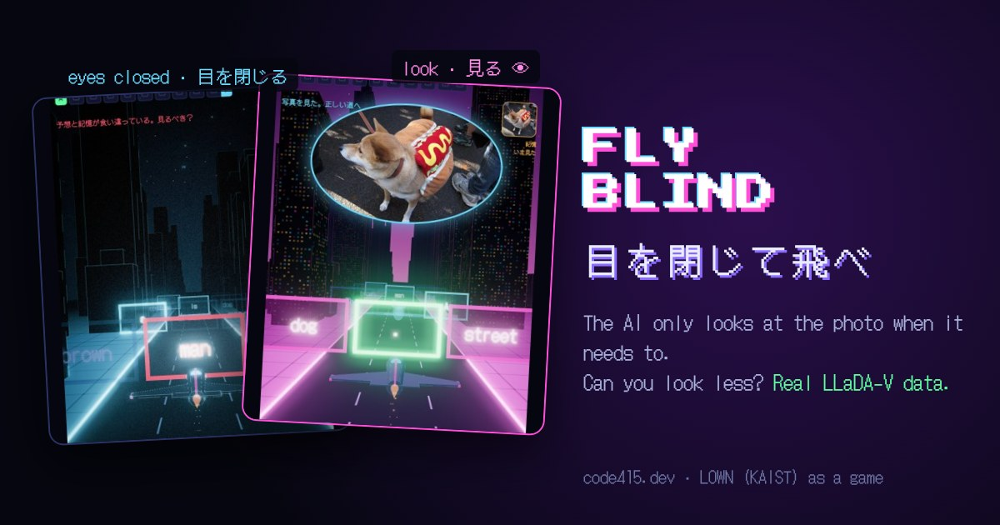

# Fly Blind · 目を閉じて飛べ

A browser game about **LOWN**, "Look Only When Needed" (KAIST, arXiv 2610.36671): a diffusion vision-language model checks a cheap guess without the image at every step and only runs the expensive pass with the image when the guess disagrees with what it saw last time.

You fly through gates with your eyes closed. Each gate is one decoding step of **LLaDA-V** describing a photo you can't see, and its three lanes are candidate tokens. The dashed lane is the model's guess without the photo. Press 👁 to look at the photo, which costs compute. When the guess matches your memory from the last look the gate turns green; when it disagrees it blinks red. A ghost plane flies with LOWN's check. Score is looks plus 3 per mistake; lower wins.

**Play:** https://code415.dev/demos/2026-11-01/fly-blind

## The data is real

`data/traces.json` was recorded by running [GSAI-ML/LLaDA-V](https://huggingface.co/GSAI-ML/LLaDA-V) (fp16, PyTorch MPS on an Apple M4 Pro) on 24 Wikimedia Commons photos. For every step of the always-look decode (one token per step), it stores the top-3 candidates of the pass with the image and of the pass without it. The game builds its gates from these records; nothing is simulated.

Measured on the gates the game shows (240 steps; punctuation and end-of-text are filled automatically and excluded):

| | |
|---|---|
| steps where the guess without the image picked a different token | 50.0% |
| steps where LOWN's check looked at the image, replayed on the same run | 67.9% |
| photos where that replay matched the always-look caption at every step | 19 / 24 |

The ghost uses LOWN's check (trust when the guess matches memory, look when it doesn't), but the order in which blanks are filled follows the always-look run. It is not a full LOWN decode.
| median GPU time, pass with image / without | 5.5 s / 0.57 s |

Setup differences from the paper: one 384 px image tile instead of anyres_max_4, English one-sentence captions of 12 tokens, LOWN's check replayed on the always-look trajectory rather than a separate LOWN decode, and weights streamed from disk one layer at a time because memory was short. Image tokens are about 94% of the input, inside the paper's 89 to 97%. These numbers are not comparable with the paper's (99.6% of the score at 35.3% of decoding FLOPs, authors' numbers).

## Files

- `src/` the game: `core.js` (levels, LOWN's check, scoring, share text), `scene3d.js` (Three.js scene), `game.js` (loop and UI), `strings.js` (ja / en), `page.html`
- `build.py` inlines everything into one page: `python3 build.py data/traces.json docs "" pages`
- `test/core.test.js` unit tests: `node test/core.test.js data/traces.json`
- `recorder/` the scripts that produced the traces (needs the LOWN code from https://github.com/hyeon9698/LOWN, torch and transformers)
- `docs/` the GitHub Pages build

## Licenses

Code: MIT. Photos: their own Creative Commons or public domain licenses, see [PHOTOS.md](PHOTOS.md). Three.js: MIT.

## 日本語

論文 LOWN（KAIST）のしくみを、目を閉じて飛ぶゲームにしました。ゲートは LLaDA-V が見えない写真を説明するときの1ステップで、3つの道はその候補です。点線は写真なしの予想。👁 で写真を見ると正しい道がわかりますが、計算コストがかかります。データは LLaDA-V を実際に動かして記録したものです。

Made by [@Code415zg](https://x.com/Code415zg) with Claude.
